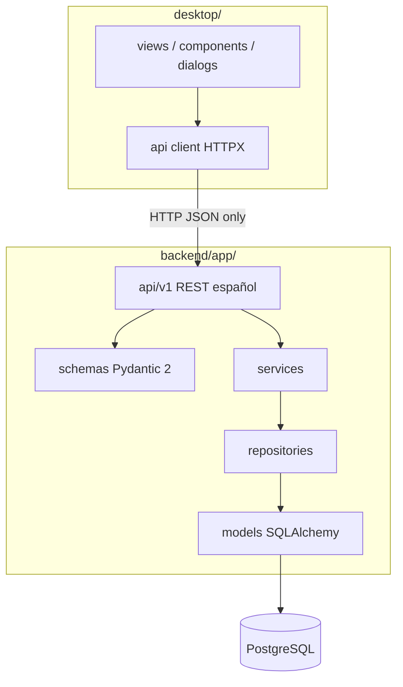

# Arquitectura — SubliManager V1

Documento de entrega alineado al código en `main` (Stages 1–10). Nomenclatura: [`nomenclatura.md`](nomenclatura.md). Schema: [`diccionario-datos.md`](diccionario-datos.md). Reglas: [`reglas-negocio.md`](reglas-negocio.md).

## 1. Vista general

SubliManager es una aplicación de escritorio con **backend y cliente desacoplados**:

| Capa | Tecnología | Rol |
|------|------------|-----|
| Desktop | CustomTkinter + HTTPX + Matplotlib | UI, navegación, presentación |
| API | FastAPI / Uvicorn | Único canal REST (`/api/v1/…` en español) |
| Dominio | Services Python | Reglas §5.1–5.10 + reportes |
| Persistencia | SQLAlchemy 2.0 + Alembic + PostgreSQL (Psycopg 3) | 36 tablas, transacciones |

### Frontera REST-only (invariante)

1. El desktop **nunca** importa SQLAlchemy ni abre conexiones a PostgreSQL.  
2. Las views **nunca** implementan reglas de negocio (costos, saldos, promedio ponderado, descuentos de inventario).  
3. Toda operación importante pasa por **Services** dentro de transacciones.  
4. Credenciales solo vía `.env` (el repo solo tiene `.env.example`).  
5. PostgreSQL es la única BD principal (SQLite prohibido).

## 2. Capas del backend (`backend/app/`)

| Carpeta | Responsabilidad |
|---------|-----------------|
| `core/` | Config, engine/session, excepciones, constantes, logging |
| `models/` | 36 tablas (paquetes A–G) + enums español |
| `schemas/` | DTOs Pydantic create/update/read |
| `repositories/` | Persistencia y consultas; sin orquestar multi-agregado |
| `services/` | Autoridad de reglas + `ReportesService` |
| `api/v1/` | Routers delgados; paths kebab-case español |
| `utils/` | `decimal_policy.py` (ROUND_HALF_UP), exportación CSV/PDF |

### Módulos lógicos

| Código | Nombre | Tablas núcleo |
|--------|--------|---------------|
| A | Inventario | `categorias_material` … `items_movimiento_inventario` |
| B | Productos | `categorias_producto` … `tecnicas_producto` |
| C | Recetas y costos | `recetas_producto` … `categorias_costo` |
| D | Clientes y pedidos | `clientes` … `historial_estado_pedido` |
| E | Producción | `ordenes_produccion` … `asientos_costo_produccion` |
| F | Compras | `proveedores`, `compras`, `items_compra` |
| G | Finanzas | `metodos_pago` … `movimientos_caja` |

## 3. Cliente desktop (`desktop/`)

| Carpeta | Rol |
|---------|-----|
| `api/` | Cliente HTTPX tipado |
| `views/` | Pantallas por menú |
| `components/` / `dialogs/` | Tablas, forms, toasts, charts |
| `styles/` | Paleta (sidebar `#172033`, primary `#2563EB`, …) |
| `utils/async_ui.py` | HTTP fuera del hilo UI |

Menú: GENERAL · VENTAS · PRODUCCIÓN · INVENTARIO · FINANZAS · REPORTES · CONFIGURACIÓN.

## 4. Transacciones y dinero

Operaciones multi-tabla (recepción de compra, consumo de OP, pago confirmado + caja, entrega REVENTA, cierre de OP, transferencias) corren en **una** transacción SQLAlchemy. Cualquier error → rollback completo.

| Concepto | BD | Python |
|----------|-----|--------|
| Dinero | `NUMERIC(14,2)` | `Decimal` |
| Cantidades | `NUMERIC(14,4)` | `Decimal` |
| Porcentajes | `NUMERIC(5,2)` | `Decimal` |

**Prohibido:** `float` para dinero o stock en Services/cálculos. Redondeo: **ROUND_HALF_UP** (`money_round` / `qty_round`).

## 5. Acoplamientos

**Permitidos (dirección preferida):** compras → inventario; producción → inventario/recetas/pedidos; finanzas → pedidos/compras; productos/recetas → materiales.

**Prohibidos:** desktop → PG; routers con lógica de promedio/saldos; finanzas creando `existencias` directo; pedidos descontando materiales al crear; borrar movimientos `CONFIRMADO`; OP sin `pedido_id` en V1.

## 6. Seguridad (V1)

Sin auth multi-usuario. Reservado en `core/config` para fases posteriores. Diseños: solo rutas en `DESIGNS_ROOT`, no binarios en BD.

## 7. Testing

| Nivel | Enfoque |
|-------|---------|
| Unitario Services | Decimal, saldos, promedio |
| API | HTTPX / TestClient, contratos español |
| Integración + E2E | PostgreSQL de prueba; escenario vaso sublimable Stage 10 |
| UI | Smoke manual Stages 8–9 |

## 8. Fuera de alcance V1

- SQLite como BD principal  
- Microservicios / event bus distribuido  
- Agentes / LLM dentro de la app  
- OP interna sin pedido de cliente  
- Auth multi-usuario  

Resumen de endpoints: [`api.md`](api.md).
