# Diccionario de datos — SubliManager V1 (36 tablas)

**Versión:** V1 entrega (Stage 11) — alineado a modelos en `backend/app/models/` y migración `20261106_0002`.  
**Nomenclatura:** [`nomenclatura.md`](nomenclatura.md) · **ER:** [`er-diagrama.md`](er-diagrama.md) · **Extracto corto:** [`database.md`](database.md)

**Convenciones de tipos (§4 master prompt):**
- PK: `BIGINT` identity/serial → columna `id`
- Dinero: `NUMERIC(14,2)`
- Cantidades: `NUMERIC(14,4)`
- Porcentajes: `NUMERIC(5,2)`
- Fechas: `TIMESTAMPTZ`
- Textos cortos: `VARCHAR(n)`
- Descripciones: `TEXT`
- Flags: `BOOLEAN`

**Decisiones de producto (congeladas en V1):**
- Identificadores de negocio en **español** (tablas, columnas, enums, paths API).
- `ordenes_produccion.pedido_id` es **NOT NULL** en V1 (OP interna sin pedido → fase posterior).
- Descuento de pedido = **monto** monetario.
- Adiciones en las mismas 36 tablas: `movimientos_inventario.estado`, `movimientos_inventario.grupo_transferencia_id`.

---

## Diagrama ER (Mermaid) — módulos A–G

> Copia canónica también en [`er-diagrama.md`](er-diagrama.md).

```mermaid
erDiagram
  %% ===== MÓDULO A — INVENTARIO =====
  categorias_material ||--o{ materiales : categoriza
  unidades_medida ||--o{ materiales : mide
  materiales ||--o{ existencias : stock
  materiales ||--o{ items_movimiento_inventario : movido
  bodegas ||--o{ existencias : aloja
  bodegas ||--o{ movimientos_inventario : sede
  movimientos_inventario ||--o{ items_movimiento_inventario : lineas
  variantes_producto ||--o{ existencias : stock_terminado
  variantes_producto ||--o{ items_movimiento_inventario : mov_terminado

  categorias_material {
    BIGINT id PK
    VARCHAR nombre
    TEXT descripcion
    BOOLEAN activo
    TIMESTAMPTZ creado_en
  }
  unidades_medida {
    BIGINT id PK
    VARCHAR nombre
    VARCHAR abreviatura
    BOOLEAN activo
  }
  materiales {
    BIGINT id PK
    BIGINT categoria_id FK
    BIGINT unidad_id FK
    VARCHAR nombre
    TEXT descripcion
    NUMERIC stock_minimo
    NUMERIC costo_promedio
    BOOLEAN activo
    TIMESTAMPTZ creado_en
    TIMESTAMPTZ actualizado_en
  }
  bodegas {
    BIGINT id PK
    VARCHAR nombre
    VARCHAR ubicacion
    BOOLEAN activo
  }
  existencias {
    BIGINT id PK
    BIGINT bodega_id FK
    BIGINT material_id FK
    BIGINT variante_producto_id FK
    NUMERIC cantidad
    TIMESTAMPTZ actualizado_en
  }
  movimientos_inventario {
    BIGINT id PK
    VARCHAR tipo_movimiento
    VARCHAR estado
    UUID grupo_transferencia_id
    VARCHAR tipo_referencia
    BIGINT referencia_id
    BIGINT bodega_id FK
    TIMESTAMPTZ fecha_movimiento
    TEXT notas
    TIMESTAMPTZ creado_en
  }
  items_movimiento_inventario {
    BIGINT id PK
    BIGINT movimiento_id FK
    BIGINT material_id FK
    BIGINT variante_producto_id FK
    NUMERIC cantidad
    NUMERIC costo_unitario
    NUMERIC costo_total
  }

  %% ===== MÓDULO B — PRODUCTOS =====
  categorias_producto ||--o{ productos : categoriza
  productos ||--o{ variantes_producto : tiene
  productos ||--o{ tecnicas_producto : usa
  tecnicas_produccion ||--o{ tecnicas_producto : aplicada

  categorias_producto {
    BIGINT id PK
    VARCHAR nombre
    TEXT descripcion
    BOOLEAN activo
  }
  productos {
    BIGINT id PK
    BIGINT categoria_id FK
    VARCHAR nombre
    TEXT descripcion
    VARCHAR tipo_producto
    BOOLEAN activo
    TIMESTAMPTZ creado_en
    TIMESTAMPTZ actualizado_en
  }
  variantes_producto {
    BIGINT id PK
    BIGINT producto_id FK
    VARCHAR sku UK
    VARCHAR talla
    VARCHAR color
    NUMERIC precio_venta
    BOOLEAN control_stock
    BOOLEAN activo
  }
  tecnicas_produccion {
    BIGINT id PK
    VARCHAR nombre
    TEXT descripcion
    BOOLEAN activo
  }
  tecnicas_producto {
    BIGINT id PK
    BIGINT producto_id FK
    BIGINT tecnica_id FK
  }

  %% ===== MÓDULO C — RECETAS Y COSTOS =====
  productos ||--o{ recetas_producto : recetas
  variantes_producto ||--o{ recetas_producto : receta_variante
  recetas_producto ||--o{ items_receta_producto : lineas
  materiales ||--o{ items_receta_producto : ingrediente
  productos ||--o{ perfiles_costo_producto : costado
  variantes_producto ||--o{ perfiles_costo_producto : costo_variante

  recetas_producto {
    BIGINT id PK
    BIGINT producto_id FK
    BIGINT variante_id FK
    INT version
    VARCHAR nombre
    BOOLEAN activo
    TIMESTAMPTZ creado_en
  }
  items_receta_producto {
    BIGINT id PK
    BIGINT receta_id FK
    BIGINT material_id FK
    NUMERIC cantidad
    NUMERIC porcentaje_desperdicio
    TEXT notas
  }
  perfiles_costo_producto {
    BIGINT id PK
    BIGINT producto_id FK
    BIGINT variante_id FK
    NUMERIC costo_mano_obra_por_unidad
    NUMERIC costo_electricidad_por_unidad
    NUMERIC costo_depreciacion_por_unidad
    NUMERIC costo_otros_por_unidad
    TIMESTAMPTZ vigente_desde
    BOOLEAN activo
  }
  categorias_costo {
    BIGINT id PK
    VARCHAR nombre
    VARCHAR tipo_costo
    BOOLEAN activo
  }

  %% ===== MÓDULO D — CLIENTES Y PEDIDOS =====
  clientes ||--o{ pedidos : realiza
  pedidos ||--o{ items_pedido : lineas
  pedidos ||--o{ historial_estado_pedido : historial
  productos ||--o{ items_pedido : vendido
  variantes_producto ||--o{ items_pedido : variante
  items_pedido ||--o{ disenos_pedido : disenos

  clientes {
    BIGINT id PK
    VARCHAR nombre
    VARCHAR identificacion
    VARCHAR telefono
    VARCHAR email
    TEXT direccion
    TEXT notas
    BOOLEAN activo
    TIMESTAMPTZ creado_en
  }
  pedidos {
    BIGINT id PK
    VARCHAR numero_pedido UK
    BIGINT cliente_id FK
    TIMESTAMPTZ fecha_pedido
    TIMESTAMPTZ fecha_entrega
    NUMERIC subtotal
    NUMERIC descuento
    NUMERIC total
    VARCHAR estado
    TEXT notas
    TIMESTAMPTZ creado_en
    TIMESTAMPTZ actualizado_en
  }
  items_pedido {
    BIGINT id PK
    BIGINT pedido_id FK
    BIGINT producto_id FK
    BIGINT variante_id FK
    TEXT descripcion
    NUMERIC cantidad
    NUMERIC precio_venta_unitario
    NUMERIC costo_unitario_estimado
    NUMERIC subtotal
  }
  disenos_pedido {
    BIGINT id PK
    BIGINT item_pedido_id FK
    VARCHAR ruta_archivo
    INT version
    VARCHAR estado_aprobacion
    TEXT notas
    TIMESTAMPTZ creado_en
  }
  historial_estado_pedido {
    BIGINT id PK
    BIGINT pedido_id FK
    VARCHAR estado_anterior
    VARCHAR estado_nuevo
    TIMESTAMPTZ cambiado_en
    TEXT notas
  }

  %% ===== MÓDULO E — PRODUCCIÓN =====
  pedidos ||--o{ ordenes_produccion : genera
  ordenes_produccion ||--o{ items_orden_produccion : lineas
  items_pedido ||--o{ items_orden_produccion : desde_item
  items_orden_produccion ||--o{ consumos_produccion : consume
  items_orden_produccion ||--o{ asientos_costo_produccion : costos
  materiales ||--o{ consumos_produccion : material
  categorias_costo ||--o{ asientos_costo_produccion : categoria
  gastos ||--o{ asientos_costo_produccion : gasto_enlazado

  ordenes_produccion {
    BIGINT id PK
    BIGINT pedido_id FK
    VARCHAR numero_produccion
    VARCHAR estado
    TIMESTAMPTZ fecha_inicio
    TIMESTAMPTZ fecha_fin
    TEXT notas
  }
  items_orden_produccion {
    BIGINT id PK
    BIGINT orden_produccion_id FK
    BIGINT item_pedido_id FK
    NUMERIC cantidad_planificada
    NUMERIC cantidad_producida
    NUMERIC cantidad_rechazada
  }
  consumos_produccion {
    BIGINT id PK
    BIGINT item_orden_produccion_id FK
    BIGINT material_id FK
    NUMERIC cantidad_consumida
    NUMERIC costo_unitario_snapshot
    NUMERIC costo_total
    TIMESTAMPTZ consumido_en
    BOOLEAN es_desperdicio
    TEXT notas
  }
  asientos_costo_produccion {
    BIGINT id PK
    BIGINT item_orden_produccion_id FK
    BIGINT categoria_costo_id FK
    BIGINT gasto_id FK
    TEXT descripcion
    VARCHAR etapa_costo
    NUMERIC cantidad
    NUMERIC costo_unitario
    NUMERIC costo_total
    TIMESTAMPTZ creado_en
  }

  %% ===== MÓDULO F — COMPRAS =====
  proveedores ||--o{ compras : surte
  compras ||--o{ items_compra : lineas
  materiales ||--o{ items_compra : mat_comprado
  variantes_producto ||--o{ items_compra : var_comprada

  proveedores {
    BIGINT id PK
    VARCHAR nombre
    VARCHAR identificacion
    VARCHAR telefono
    VARCHAR email
    TEXT direccion
    BOOLEAN activo
  }
  compras {
    BIGINT id PK
    BIGINT proveedor_id FK
    TIMESTAMPTZ fecha_compra
    VARCHAR numero_factura
    NUMERIC subtotal
    NUMERIC total
    VARCHAR estado
    TIMESTAMPTZ creado_en
  }
  items_compra {
    BIGINT id PK
    BIGINT compra_id FK
    BIGINT material_id FK
    BIGINT variante_producto_id FK
    NUMERIC cantidad
    NUMERIC costo_unitario
    NUMERIC subtotal
  }

  %% ===== MÓDULO G — FINANZAS =====
  pedidos ||--o{ pagos : cobrado
  metodos_pago ||--o{ pagos : metodo
  cuentas_caja ||--o{ pagos : cuenta
  categorias_gasto ||--o{ gastos : categoriza
  gastos ||--o{ pagos_gasto : pagado
  metodos_pago ||--o{ pagos_gasto : metodo
  cuentas_caja ||--o{ pagos_gasto : cuenta
  compras ||--o{ pagos_proveedor : pagado
  metodos_pago ||--o{ pagos_proveedor : metodo
  cuentas_caja ||--o{ pagos_proveedor : cuenta
  cuentas_caja ||--o{ movimientos_caja : mayor
  pagos ||--o{ movimientos_caja : desde_pago
  pagos_proveedor ||--o{ movimientos_caja : desde_pago_prov
  pagos_gasto ||--o{ movimientos_caja : desde_pago_gasto

  metodos_pago {
    BIGINT id PK
    VARCHAR nombre
    BOOLEAN activo
  }
  cuentas_caja {
    BIGINT id PK
    VARCHAR nombre
    VARCHAR tipo_cuenta
    BOOLEAN activo
  }
  pagos {
    BIGINT id PK
    BIGINT pedido_id FK
    BIGINT metodo_pago_id FK
    BIGINT cuenta_caja_id FK
    NUMERIC monto
    TIMESTAMPTZ fecha_pago
    VARCHAR referencia
    VARCHAR estado
    TEXT notas
  }
  categorias_gasto {
    BIGINT id PK
    VARCHAR nombre
    TEXT descripcion
    BOOLEAN activo
  }
  gastos {
    BIGINT id PK
    BIGINT categoria_id FK
    TEXT descripcion
    NUMERIC monto
    TIMESTAMPTZ fecha_gasto
    VARCHAR estado_pago
    TEXT notas
  }
  pagos_gasto {
    BIGINT id PK
    BIGINT gasto_id FK
    BIGINT metodo_pago_id FK
    BIGINT cuenta_caja_id FK
    NUMERIC monto
    TIMESTAMPTZ fecha_pago
    VARCHAR estado
    VARCHAR referencia
  }
  pagos_proveedor {
    BIGINT id PK
    BIGINT compra_id FK
    BIGINT metodo_pago_id FK
    BIGINT cuenta_caja_id FK
    NUMERIC monto
    TIMESTAMPTZ fecha_pago
    VARCHAR estado
    VARCHAR referencia
  }
  movimientos_caja {
    BIGINT id PK
    BIGINT cuenta_caja_id FK
    VARCHAR tipo_movimiento
    NUMERIC monto
    BIGINT pago_id FK
    BIGINT pago_proveedor_id FK
    BIGINT pago_gasto_id FK
    TIMESTAMPTZ fecha_movimiento
    TEXT descripcion
  }
```




---

## MÓDULO A — Inventario

### 1. `categorias_material`
| Campo | Tipo | Nulo | Notas |
|-------|------|------|-------|
| id | BIGINT PK | NO | |
| nombre | VARCHAR(120) | NO | |
| descripcion | TEXT | YES | |
| activo | BOOLEAN | NO | default true |
| creado_en | TIMESTAMPTZ | NO | |

**Constraints:** `UNIQUE(nombre)` recomendado.

### 2. `unidades_medida`
| Campo | Tipo | Nulo | Notas |
|-------|------|------|-------|
| id | BIGINT PK | NO | |
| nombre | VARCHAR(60) | NO | unidad, ml, l, m, g, kg, hoja, paquete… |
| abreviatura | VARCHAR(16) | NO | |
| activo | BOOLEAN | NO | |

### 3. `materiales`
| Campo | Tipo | Nulo | Notas |
|-------|------|------|-------|
| id | BIGINT PK | NO | |
| categoria_id | BIGINT FK → categorias_material | NO | |
| unidad_id | BIGINT FK → unidades_medida | NO | |
| nombre | VARCHAR(200) | NO | |
| descripcion | TEXT | YES | |
| stock_minimo | NUMERIC(14,4) | NO | ≥ 0 |
| costo_promedio | NUMERIC(14,2) | NO | no editar libremente |
| activo | BOOLEAN | NO | |
| creado_en | TIMESTAMPTZ | NO | |
| actualizado_en | TIMESTAMPTZ | NO | |

**Check:** `stock_minimo >= 0`, `costo_promedio >= 0`.

### 4. `bodegas`
| Campo | Tipo | Nulo | Notas |
|-------|------|------|-------|
| id | BIGINT PK | NO | |
| nombre | VARCHAR(120) | NO | |
| ubicacion | VARCHAR(255) | YES | |
| activo | BOOLEAN | NO | |

### 5. `existencias`
| Campo | Tipo | Nulo | Notas |
|-------|------|------|-------|
| id | BIGINT PK | NO | |
| bodega_id | BIGINT FK → bodegas | NO | |
| material_id | BIGINT FK → materiales | YES | XOR con variante |
| variante_producto_id | BIGINT FK → variantes_producto | YES | XOR con material |
| cantidad | NUMERIC(14,4) | NO | ≥ 0 |
| actualizado_en | TIMESTAMPTZ | NO | |

**Checks:**  
`(material_id IS NOT NULL AND variante_producto_id IS NULL) OR (material_id IS NULL AND variante_producto_id IS NOT NULL)`  
`cantidad >= 0`

**Unique parcial:**
- `UNIQUE(bodega_id, material_id)` WHERE material_id IS NOT NULL  
- `UNIQUE(bodega_id, variante_producto_id)` WHERE variante_producto_id IS NOT NULL

### 6. `movimientos_inventario`
| Campo | Tipo | Nulo | Notas |
|-------|------|------|-------|
| id | BIGINT PK | NO | |
| tipo_movimiento | VARCHAR(32) | NO | enum abajo |
| estado | VARCHAR(16) | NO | **APROBADO:** `BORRADOR \| CONFIRMADO \| ANULADO` |
| grupo_transferencia_id | UUID | YES | **APROBADO:** empareja transferencia IN/OUT |
| tipo_referencia | VARCHAR(64) | YES | p.ej. compra, orden_produccion, pedido |
| referencia_id | BIGINT | YES | id polimórfico |
| bodega_id | BIGINT FK → bodegas | NO | |
| fecha_movimiento | TIMESTAMPTZ | NO | |
| notas | TEXT | YES | |
| creado_en | TIMESTAMPTZ | NO | |

**tipo_movimiento ∈** `COMPRA, PRODUCCION, AJUSTE, DESPERDICIO, DEVOLUCION, TRANSFERENCIA_ENTRADA, TRANSFERENCIA_SALIDA, VENTA, REVERSO`.

**Reglas:** filas `CONFIRMADO` MUST NOT eliminarse; anulación vía `REVERSO` / `ANULADO`. Transferencias: mismo `grupo_transferencia_id` en el par SALIDA/ENTRADA.

### 7. `items_movimiento_inventario`
| Campo | Tipo | Nulo | Notas |
|-------|------|------|-------|
| id | BIGINT PK | NO | |
| movimiento_id | BIGINT FK → movimientos_inventario | NO | ON DELETE restringido si confirmado |
| material_id | BIGINT FK | YES | XOR |
| variante_producto_id | BIGINT FK | YES | XOR |
| cantidad | NUMERIC(14,4) | NO | > 0 |
| costo_unitario | NUMERIC(14,2) | NO | |
| costo_total | NUMERIC(14,2) | NO | |

**Checks:** XOR artículo; `cantidad > 0`; `costo_total >= 0`.

---

## MÓDULO B — Productos

### 8. `categorias_producto`
| Campo | Tipo | Nulo | Notas |
|-------|------|------|-------|
| id | BIGINT PK | NO | |
| nombre | VARCHAR(120) | NO | |
| descripcion | TEXT | YES | |
| activo | BOOLEAN | NO | |

### 9. `productos`
| Campo | Tipo | Nulo | Notas |
|-------|------|------|-------|
| id | BIGINT PK | NO | |
| categoria_id | BIGINT FK → categorias_producto | NO | |
| nombre | VARCHAR(200) | NO | |
| descripcion | TEXT | YES | |
| tipo_producto | VARCHAR(32) | NO | `FABRICADO \| REVENTA \| SERVICIO` |
| activo | BOOLEAN | NO | |
| creado_en | TIMESTAMPTZ | NO | |
| actualizado_en | TIMESTAMPTZ | NO | |

**Check:** `tipo_producto IN ('FABRICADO','REVENTA','SERVICIO')`.

### 10. `variantes_producto`
| Campo | Tipo | Nulo | Notas |
|-------|------|------|-------|
| id | BIGINT PK | NO | |
| producto_id | BIGINT FK → productos | NO | |
| sku | VARCHAR(64) | NO | UNIQUE (código internacional) |
| talla | VARCHAR(64) | YES | |
| color | VARCHAR(64) | YES | |
| precio_venta | NUMERIC(14,2) | NO | ≥ 0 |
| control_stock | BOOLEAN | NO | |
| activo | BOOLEAN | NO | |

### 11. `tecnicas_produccion`
| Campo | Tipo | Nulo | Notas |
|-------|------|------|-------|
| id | BIGINT PK | NO | |
| nombre | VARCHAR(120) | NO | |
| descripcion | TEXT | YES | |
| activo | BOOLEAN | NO | |

### 12. `tecnicas_producto`
| Campo | Tipo | Nulo | Notas |
|-------|------|------|-------|
| id | BIGINT PK | NO | |
| producto_id | BIGINT FK → productos | NO | |
| tecnica_id | BIGINT FK → tecnicas_produccion | NO | |

**Unique:** `UNIQUE(producto_id, tecnica_id)`.

---

## MÓDULO C — Recetas y costos

### 13. `recetas_producto`
| Campo | Tipo | Nulo | Notas |
|-------|------|------|-------|
| id | BIGINT PK | NO | |
| producto_id | BIGINT FK → productos | NO | |
| variante_id | BIGINT FK → variantes_producto | YES | genérica o por variante |
| version | INT | NO | conservar versiones |
| nombre | VARCHAR(120) | NO | |
| activo | BOOLEAN | NO | |
| creado_en | TIMESTAMPTZ | NO | |

**Unique propuesto:** `UNIQUE(producto_id, variante_id, version)` (NULL variante → índice parcial en migración).

### 14. `items_receta_producto`
| Campo | Tipo | Nulo | Notas |
|-------|------|------|-------|
| id | BIGINT PK | NO | |
| receta_id | BIGINT FK → recetas_producto | NO | |
| material_id | BIGINT FK → materiales | NO | |
| cantidad | NUMERIC(14,4) | NO | > 0 |
| porcentaje_desperdicio | NUMERIC(5,2) | NO | ≥ 0 |
| notas | TEXT | YES | |

### 15. `perfiles_costo_producto`
| Campo | Tipo | Nulo | Notas |
|-------|------|------|-------|
| id | BIGINT PK | NO | |
| producto_id | BIGINT FK → productos | NO | |
| variante_id | BIGINT FK → variantes_producto | YES | |
| costo_mano_obra_por_unidad | NUMERIC(14,2) | NO | |
| costo_electricidad_por_unidad | NUMERIC(14,2) | NO | |
| costo_depreciacion_por_unidad | NUMERIC(14,2) | NO | |
| costo_otros_por_unidad | NUMERIC(14,2) | NO | |
| vigente_desde | TIMESTAMPTZ | NO | no sobrescribir históricos |
| activo | BOOLEAN | NO | |

### 16. `categorias_costo`
| Campo | Tipo | Nulo | Notas |
|-------|------|------|-------|
| id | BIGINT PK | NO | |
| nombre | VARCHAR(120) | NO | |
| tipo_costo | VARCHAR(32) | NO | `MATERIAL \| MANO_OBRA \| ELECTRICIDAD \| DEPRECIACION \| MANTENIMIENTO \| EMPAQUE \| OTRO` |
| activo | BOOLEAN | NO | |

---

## MÓDULO D — Clientes y pedidos

### 17. `clientes`
| Campo | Tipo | Nulo | Notas |
|-------|------|------|-------|
| id | BIGINT PK | NO | |
| nombre | VARCHAR(200) | NO | |
| identificacion | VARCHAR(64) | YES | |
| telefono | VARCHAR(40) | YES | |
| email | VARCHAR(120) | YES | |
| direccion | TEXT | YES | |
| notas | TEXT | YES | |
| activo | BOOLEAN | NO | |
| creado_en | TIMESTAMPTZ | NO | |

### 18. `pedidos`
| Campo | Tipo | Nulo | Notas |
|-------|------|------|-------|
| id | BIGINT PK | NO | |
| numero_pedido | VARCHAR(40) | NO | UNIQUE |
| cliente_id | BIGINT FK → clientes | NO | |
| fecha_pedido | TIMESTAMPTZ | NO | |
| fecha_entrega | TIMESTAMPTZ | YES | |
| subtotal | NUMERIC(14,2) | NO | |
| descuento | NUMERIC(14,2) | NO | **APROBADO: monto monetario** (no %) |
| total | NUMERIC(14,2) | NO | |
| estado | VARCHAR(32) | NO | enum abajo |
| notas | TEXT | YES | |
| creado_en | TIMESTAMPTZ | NO | |
| actualizado_en | TIMESTAMPTZ | NO | |

**estado ∈** `PENDIENTE, CONFIRMADO, DISENO, ESPERANDO_APROBACION, EN_PRODUCCION, LISTO, ENTREGADO, CANCELADO`.

### 19. `items_pedido`
| Campo | Tipo | Nulo | Notas |
|-------|------|------|-------|
| id | BIGINT PK | NO | |
| pedido_id | BIGINT FK → pedidos | NO | |
| producto_id | BIGINT FK → productos | NO | |
| variante_id | BIGINT FK → variantes_producto | YES | |
| descripcion | TEXT | YES | |
| cantidad | NUMERIC(14,4) | NO | > 0 |
| precio_venta_unitario | NUMERIC(14,2) | NO | snapshot |
| costo_unitario_estimado | NUMERIC(14,2) | NO | snapshot |
| subtotal | NUMERIC(14,2) | NO | |

### 20. `disenos_pedido`
| Campo | Tipo | Nulo | Notas |
|-------|------|------|-------|
| id | BIGINT PK | NO | |
| item_pedido_id | BIGINT FK → items_pedido | NO | |
| ruta_archivo | VARCHAR(1024) | NO | ruta, no binario |
| version | INT | NO | |
| estado_aprobacion | VARCHAR(32) | NO | `BORRADOR \| PENDIENTE_APROBACION \| APROBADO \| RECHAZADO` |
| notas | TEXT | YES | |
| creado_en | TIMESTAMPTZ | NO | |

### 21. `historial_estado_pedido`
| Campo | Tipo | Nulo | Notas |
|-------|------|------|-------|
| id | BIGINT PK | NO | |
| pedido_id | BIGINT FK → pedidos | NO | |
| estado_anterior | VARCHAR(32) | YES | null en alta inicial |
| estado_nuevo | VARCHAR(32) | NO | |
| cambiado_en | TIMESTAMPTZ | NO | |
| notas | TEXT | YES | |

---

## MÓDULO E — Producción

### 22. `ordenes_produccion`
| Campo | Tipo | Nulo | Notas |
|-------|------|------|-------|
| id | BIGINT PK | NO | |
| pedido_id | BIGINT FK → pedidos | **NO** | **APROBADO V1: NOT NULL.** OP sin pedido diferida a fase posterior. |
| numero_produccion | VARCHAR(40) | NO | UNIQUE recomendado |
| estado | VARCHAR(32) | NO | `PLANIFICADA \| EN_PROCESO \| COMPLETADA \| CANCELADA` |
| fecha_inicio | TIMESTAMPTZ | YES | |
| fecha_fin | TIMESTAMPTZ | YES | |
| notas | TEXT | YES | |

> **Decisión de producto:** la recomendación previa de hacer `order_id`/`pedido_id` nullable queda **SUPERSEDED**. En V1 toda OP exige pedido de cliente.

### 23. `items_orden_produccion`
| Campo | Tipo | Nulo | Notas |
|-------|------|------|-------|
| id | BIGINT PK | NO | |
| orden_produccion_id | BIGINT FK → ordenes_produccion | NO | |
| item_pedido_id | BIGINT FK → items_pedido | NO | requerido en V1 (ligado a pedido) |
| cantidad_planificada | NUMERIC(14,4) | NO | > 0 |
| cantidad_producida | NUMERIC(14,4) | NO | ≥ 0 |
| cantidad_rechazada | NUMERIC(14,4) | NO | ≥ 0 |

**Check:** `cantidad_producida + cantidad_rechazada <= cantidad_planificada`.

### 24. `consumos_produccion`
| Campo | Tipo | Nulo | Notas |
|-------|------|------|-------|
| id | BIGINT PK | NO | |
| item_orden_produccion_id | BIGINT FK → items_orden_produccion | NO | |
| material_id | BIGINT FK → materiales | NO | |
| cantidad_consumida | NUMERIC(14,4) | NO | > 0 |
| costo_unitario_snapshot | NUMERIC(14,2) | NO | |
| costo_total | NUMERIC(14,2) | NO | |
| consumido_en | TIMESTAMPTZ | NO | |
| es_desperdicio | BOOLEAN | NO | |
| notas | TEXT | YES | |

### 25. `asientos_costo_produccion`
| Campo | Tipo | Nulo | Notas |
|-------|------|------|-------|
| id | BIGINT PK | NO | |
| item_orden_produccion_id | BIGINT FK → items_orden_produccion | NO | |
| categoria_costo_id | BIGINT FK → categorias_costo | NO | |
| gasto_id | BIGINT FK → gastos | YES | |
| descripcion | TEXT | YES | |
| etapa_costo | VARCHAR(16) | NO | `ESTIMADO \| REAL` |
| cantidad | NUMERIC(14,4) | NO | |
| costo_unitario | NUMERIC(14,2) | NO | |
| costo_total | NUMERIC(14,2) | NO | |
| creado_en | TIMESTAMPTZ | NO | |

**Check:** `etapa_costo IN ('ESTIMADO','REAL')`.

---

## MÓDULO F — Compras

### 26. `proveedores`
| Campo | Tipo | Nulo | Notas |
|-------|------|------|-------|
| id | BIGINT PK | NO | |
| nombre | VARCHAR(200) | NO | |
| identificacion | VARCHAR(64) | YES | |
| telefono | VARCHAR(40) | YES | |
| email | VARCHAR(120) | YES | |
| direccion | TEXT | YES | |
| activo | BOOLEAN | NO | |

### 27. `compras`
| Campo | Tipo | Nulo | Notas |
|-------|------|------|-------|
| id | BIGINT PK | NO | |
| proveedor_id | BIGINT FK → proveedores | NO | |
| fecha_compra | TIMESTAMPTZ | NO | |
| numero_factura | VARCHAR(80) | YES | |
| subtotal | NUMERIC(14,2) | NO | |
| total | NUMERIC(14,2) | NO | |
| estado | VARCHAR(32) | NO | `BORRADOR \| RECIBIDA \| PARCIALMENTE_RECIBIDA \| CANCELADA` |
| creado_en | TIMESTAMPTZ | NO | |

### 28. `items_compra`
| Campo | Tipo | Nulo | Notas |
|-------|------|------|-------|
| id | BIGINT PK | NO | |
| compra_id | BIGINT FK → compras | NO | |
| material_id | BIGINT FK | YES | XOR |
| variante_producto_id | BIGINT FK | YES | XOR |
| cantidad | NUMERIC(14,4) | NO | > 0 |
| costo_unitario | NUMERIC(14,2) | NO | |
| subtotal | NUMERIC(14,2) | NO | |

**Check:** XOR artículo.

---

## MÓDULO G — Finanzas

### 29. `metodos_pago`
| Campo | Tipo | Nulo | Notas |
|-------|------|------|-------|
| id | BIGINT PK | NO | |
| nombre | VARCHAR(80) | NO | seeds: Efectivo, Transferencia, Nequi, Daviplata, Otro |
| activo | BOOLEAN | NO | |

### 30. `cuentas_caja`
| Campo | Tipo | Nulo | Notas |
|-------|------|------|-------|
| id | BIGINT PK | NO | |
| nombre | VARCHAR(120) | NO | |
| tipo_cuenta | VARCHAR(32) | NO | `EFECTIVO \| BANCO \| BILLETERA_DIGITAL \| OTRO` |
| activo | BOOLEAN | NO | |

### 31. `pagos`
| Campo | Tipo | Nulo | Notas |
|-------|------|------|-------|
| id | BIGINT PK | NO | |
| pedido_id | BIGINT FK → pedidos | NO | |
| metodo_pago_id | BIGINT FK → metodos_pago | NO | |
| cuenta_caja_id | BIGINT FK → cuentas_caja | NO | |
| monto | NUMERIC(14,2) | NO | > 0 |
| fecha_pago | TIMESTAMPTZ | NO | |
| referencia | VARCHAR(120) | YES | |
| estado | VARCHAR(32) | NO | `PENDIENTE \| CONFIRMADO \| ANULADO` |
| notas | TEXT | YES | |

Solo `CONFIRMADO` mueve caja y cuenta para saldo del pedido.

### 32. `categorias_gasto`
| Campo | Tipo | Nulo | Notas |
|-------|------|------|-------|
| id | BIGINT PK | NO | |
| nombre | VARCHAR(120) | NO | |
| descripcion | TEXT | YES | |
| activo | BOOLEAN | NO | |

### 33. `gastos`
| Campo | Tipo | Nulo | Notas |
|-------|------|------|-------|
| id | BIGINT PK | NO | |
| categoria_id | BIGINT FK → categorias_gasto | NO | |
| descripcion | TEXT | NO | |
| monto | NUMERIC(14,2) | NO | > 0 |
| fecha_gasto | TIMESTAMPTZ | NO | |
| estado_pago | VARCHAR(32) | NO | `NO_PAGADO \| PARCIAL \| PAGADO \| ANULADO` |
| notas | TEXT | YES | |

### 34. `pagos_gasto`
| Campo | Tipo | Nulo | Notas |
|-------|------|------|-------|
| id | BIGINT PK | NO | |
| gasto_id | BIGINT FK → gastos | NO | |
| metodo_pago_id | BIGINT FK → metodos_pago | NO | |
| cuenta_caja_id | BIGINT FK → cuentas_caja | NO | |
| monto | NUMERIC(14,2) | NO | > 0 |
| fecha_pago | TIMESTAMPTZ | NO | |
| estado | VARCHAR(32) | NO | `PENDIENTE \| CONFIRMADO \| ANULADO` |
| referencia | VARCHAR(120) | YES | |

### 35. `pagos_proveedor`
| Campo | Tipo | Nulo | Notas |
|-------|------|------|-------|
| id | BIGINT PK | NO | |
| compra_id | BIGINT FK → compras | NO | |
| metodo_pago_id | BIGINT FK → metodos_pago | NO | |
| cuenta_caja_id | BIGINT FK → cuentas_caja | NO | |
| monto | NUMERIC(14,2) | NO | > 0 |
| fecha_pago | TIMESTAMPTZ | NO | |
| estado | VARCHAR(32) | NO | `PENDIENTE \| CONFIRMADO \| ANULADO` |
| referencia | VARCHAR(120) | YES | |

### 36. `movimientos_caja`
| Campo | Tipo | Nulo | Notas |
|-------|------|------|-------|
| id | BIGINT PK | NO | |
| cuenta_caja_id | BIGINT FK → cuentas_caja | NO | |
| tipo_movimiento | VARCHAR(32) | NO | `ENTRADA \| SALIDA` |
| monto | NUMERIC(14,2) | NO | > 0 |
| pago_id | BIGINT FK → pagos | YES | XOR origen |
| pago_proveedor_id | BIGINT FK → pagos_proveedor | YES | XOR origen |
| pago_gasto_id | BIGINT FK → pagos_gasto | YES | XOR origen |
| fecha_movimiento | TIMESTAMPTZ | NO | |
| descripcion | TEXT | YES | |

**Check (exactamente una referencia de origen):**
```
(
  (pago_id IS NOT NULL)::int +
  (pago_proveedor_id IS NOT NULL)::int +
  (pago_gasto_id IS NOT NULL)::int
) = 1
```

**Unique recomendado (anti-duplicados):** índices únicos parciales sobre `pago_id`, `pago_proveedor_id`, `pago_gasto_id` WHERE NOT NULL.

---

## Resumen de relaciones clave

| Desde | Hasta | Cardinalidad | Notas |
|-------|-------|--------------|-------|
| materiales | categorias_material, unidades_medida | N:1 | |
| existencias | bodegas + (material \| variante) | N:1 | XOR |
| items_movimiento_inventario | movimientos_inventario | N:1 | |
| variantes_producto | productos | N:1 | sku unique |
| tecnicas_producto | productos × tecnicas_produccion | N:N | unique pair |
| items_receta_producto | recetas_producto, materiales | N:1 | |
| pedidos | clientes | N:1 | |
| items_pedido | pedidos, productos | N:1 | |
| disenos_pedido | items_pedido | N:1 | |
| ordenes_produccion | pedidos | N:1 | **pedido_id NOT NULL en V1** |
| items_orden_produccion | ordenes_produccion, items_pedido | N:1 | |
| consumos_produccion | items_orden_produccion, materiales | N:1 | |
| asientos_costo_produccion | items_orden_produccion, categorias_costo | N:1 | gasto opcional |
| items_compra | compras + (material \| variante) | N:1 | XOR |
| pagos | pedidos, metodos_pago, cuentas_caja | N:1 | |
| movimientos_caja | cuentas_caja + un origen de pago | N:1 | |

---

## Conteos

| Módulo | Tablas | IDs |
|--------|--------|-----|
| A Inventario | 7 | 1–7 |
| B Productos | 5 | 8–12 |
| C Recetas/Costos | 4 | 13–16 |
| D Clientes/Pedidos | 5 | 17–21 |
| E Producción | 4 | 22–25 |
| F Compras | 3 | 26–28 |
| G Finanzas | 8 | 29–36 |
| **Total** | **36** | |

*(Más 2 columnas aprobadas en `movimientos_inventario`: `estado`, `grupo_transferencia_id` — no son tablas nuevas.)*

---

## Apéndice — Mapeo English → Español (trazabilidad al master prompt)

### Tablas

| # | Inglés (master) | Español V1 |
|---|-----------------|------------|
| 1 | material_categories | categorias_material |
| 2 | measurement_units | unidades_medida |
| 3 | materials | materiales |
| 4 | warehouses | bodegas |
| 5 | inventory_stock | existencias |
| 6 | inventory_movements | movimientos_inventario |
| 7 | inventory_movement_items | items_movimiento_inventario |
| 8 | product_categories | categorias_producto |
| 9 | products | productos |
| 10 | product_variants | variantes_producto |
| 11 | production_techniques | tecnicas_produccion |
| 12 | product_techniques | tecnicas_producto |
| 13 | product_recipes | recetas_producto |
| 14 | product_recipe_items | items_receta_producto |
| 15 | product_cost_profiles | perfiles_costo_producto |
| 16 | cost_categories | categorias_costo |
| 17 | customers | clientes |
| 18 | orders | pedidos |
| 19 | order_items | items_pedido |
| 20 | order_designs | disenos_pedido |
| 21 | order_status_history | historial_estado_pedido |
| 22 | production_orders | ordenes_produccion |
| 23 | production_order_items | items_orden_produccion |
| 24 | production_consumptions | consumos_produccion |
| 25 | production_cost_entries | asientos_costo_produccion |
| 26 | suppliers | proveedores |
| 27 | purchases | compras |
| 28 | purchase_items | items_compra |
| 29 | payment_methods | metodos_pago |
| 30 | cash_accounts | cuentas_caja |
| 31 | payments | pagos |
| 32 | expense_categories | categorias_gasto |
| 33 | expenses | gastos |
| 34 | expense_payments | pagos_gasto |
| 35 | supplier_payments | pagos_proveedor |
| 36 | cash_movements | movimientos_caja |

### Columnas frecuentes

| Inglés | Español |
|--------|---------|
| id | id |
| name | nombre |
| description | descripcion |
| active | activo |
| created_at | creado_en |
| updated_at | actualizado_en |
| category_id | categoria_id |
| unit_id | unidad_id |
| minimum_stock | stock_minimo |
| average_cost | costo_promedio |
| location | ubicacion |
| warehouse_id | bodega_id |
| material_id | material_id |
| product_variant_id | variante_producto_id |
| quantity | cantidad |
| movement_type | tipo_movimiento |
| reference_type | tipo_referencia |
| reference_id | referencia_id |
| movement_date | fecha_movimiento |
| notes | notas |
| status / confirmation | estado |
| transfer_group_id | grupo_transferencia_id |
| unit_cost | costo_unitario |
| total_cost | costo_total |
| product_type | tipo_producto |
| sku | sku |
| size | talla |
| color | color |
| sale_price | precio_venta |
| stock_control | control_stock |
| technique_id | tecnica_id |
| product_id | producto_id |
| variant_id | variante_id |
| version | version |
| waste_percentage | porcentaje_desperdicio |
| labor_cost_per_unit | costo_mano_obra_por_unidad |
| electricity_cost_per_unit | costo_electricidad_por_unidad |
| depreciation_cost_per_unit | costo_depreciacion_por_unidad |
| other_cost_per_unit | costo_otros_por_unidad |
| effective_from | vigente_desde |
| cost_type | tipo_costo |
| identification | identificacion |
| phone | telefono |
| email | email |
| address | direccion |
| order_number | numero_pedido |
| customer_id | cliente_id |
| order_date | fecha_pedido |
| delivery_date | fecha_entrega |
| subtotal | subtotal |
| discount | descuento |
| total | total |
| order_id | pedido_id |
| unit_sale_price | precio_venta_unitario |
| estimated_unit_cost | costo_unitario_estimado |
| file_path | ruta_archivo |
| approval_status | estado_aprobacion |
| previous_status | estado_anterior |
| new_status | estado_nuevo |
| changed_at | cambiado_en |
| production_number | numero_produccion |
| start_date | fecha_inicio |
| completion_date | fecha_fin |
| production_order_id | orden_produccion_id |
| order_item_id | item_pedido_id |
| planned_quantity | cantidad_planificada |
| produced_quantity | cantidad_producida |
| rejected_quantity | cantidad_rechazada |
| quantity_consumed | cantidad_consumida |
| unit_cost_snapshot | costo_unitario_snapshot |
| consumed_at | consumido_en |
| is_waste | es_desperdicio |
| cost_category_id | categoria_costo_id |
| expense_id | gasto_id |
| cost_stage | etapa_costo |
| invoice_number | numero_factura |
| purchase_date | fecha_compra |
| supplier_id | proveedor_id |
| purchase_id | compra_id |
| account_type | tipo_cuenta |
| payment_method_id | metodo_pago_id |
| cash_account_id | cuenta_caja_id |
| amount | monto |
| payment_date | fecha_pago |
| reference | referencia |
| payment_status | estado_pago |
| expense_date | fecha_gasto |
| payment_id | pago_id |
| supplier_payment_id | pago_proveedor_id |
| expense_payment_id | pago_gasto_id |
| abbreviation | abreviatura |

### Enums / status

| Inglés (master / propuesta previa) | Español V1 |
|------------------------------------|------------|
| PENDING | PENDIENTE |
| CONFIRMED | CONFIRMADO |
| DESIGN | DISENO |
| AWAITING_APPROVAL | ESPERANDO_APROBACION |
| IN_PRODUCTION | EN_PRODUCCION |
| READY | LISTO |
| DELIVERED | ENTREGADO |
| CANCELLED / CANCELLED (pago) | CANCELADO (pedido/compra) / ANULADO (pagos) |
| MANUFACTURED | FABRICADO |
| RESALE | REVENTA |
| SERVICE | SERVICIO |
| PURCHASE | COMPRA |
| PRODUCTION | PRODUCCION |
| ADJUSTMENT | AJUSTE |
| WASTE | DESPERDICIO |
| RETURN | DEVOLUCION |
| TRANSFER_IN | TRANSFERENCIA_ENTRADA |
| TRANSFER_OUT | TRANSFERENCIA_SALIDA |
| SALE | VENTA |
| REVERSAL | REVERSO |
| PLANNED | PLANIFICADA |
| IN_PROGRESS | EN_PROCESO |
| COMPLETED | COMPLETADA |
| DRAFT | BORRADOR |
| PENDING_APPROVAL | PENDIENTE_APROBACION |
| APPROVED | APROBADO |
| REJECTED | RECHAZADO |
| CASH / BANK / DIGITAL_WALLET / OTHER | EFECTIVO / BANCO / BILLETERA_DIGITAL / OTRO |
| IN / OUT | ENTRADA / SALIDA |
| ESTIMATED / ACTUAL | ESTIMADO / REAL |
| DRAFT / RECEIVED / PARTIALLY_RECEIVED | BORRADOR / RECIBIDA / PARCIALMENTE_RECIBIDA |
| UNPAID / PARTIAL / PAID | NO_PAGADO / PARCIAL / PAGADO |
| LABOR / ELECTRICITY / DEPRECIATION / MAINTENANCE / PACKAGING / OTHER | MANO_OBRA / ELECTRICIDAD / DEPRECIACION / MANTENIMIENTO / EMPAQUE / OTRO |
