# Diagrama entidad-relación — SubliManager V1

Schema español de **36 tablas** (módulos A–G), alineado a los modelos SQLAlchemy en
`backend/app/models/` y a la migración `20261106_0002`.

Diccionario campo a campo: [`diccionario-datos.md`](diccionario-datos.md).
Nomenclatura: [`nomenclatura.md`](nomenclatura.md).

## Vista Mermaid

Renderiza en GitHub, VS Code (Markdown Preview Mermaid) o [mermaid.live](https://mermaid.live).

```mermaid
erDiagram
  %% ===== MÓDULO A — INVENTARIO =====
  categorias_material ||--o{ materiales : categoriza
  unidades_medida ||--o{ materiales : mide
  materiales ||--o{ existencias : stock
  materiales ||--o{ items_movimiento_inventario : movido
  bodegas ||--o{ existencias : aloja
  bodegas ||--o{ movimientos_inventario : sede
  movimientos_inventario ||--o{ items_movimiento_inventario : lineas
  variantes_producto ||--o{ existencias : stock_terminado
  variantes_producto ||--o{ items_movimiento_inventario : mov_terminado

  categorias_material {
    BIGINT id PK
    VARCHAR nombre
    TEXT descripcion
    BOOLEAN activo
    TIMESTAMPTZ creado_en
  }
  unidades_medida {
    BIGINT id PK
    VARCHAR nombre
    VARCHAR abreviatura
    BOOLEAN activo
  }
  materiales {
    BIGINT id PK
    BIGINT categoria_id FK
    BIGINT unidad_id FK
    VARCHAR nombre
    TEXT descripcion
    NUMERIC stock_minimo
    NUMERIC costo_promedio
    BOOLEAN activo
    TIMESTAMPTZ creado_en
    TIMESTAMPTZ actualizado_en
  }
  bodegas {
    BIGINT id PK
    VARCHAR nombre
    VARCHAR ubicacion
    BOOLEAN activo
  }
  existencias {
    BIGINT id PK
    BIGINT bodega_id FK
    BIGINT material_id FK
    BIGINT variante_producto_id FK
    NUMERIC cantidad
    TIMESTAMPTZ actualizado_en
  }
  movimientos_inventario {
    BIGINT id PK
    VARCHAR tipo_movimiento
    VARCHAR estado
    UUID grupo_transferencia_id
    VARCHAR tipo_referencia
    BIGINT referencia_id
    BIGINT bodega_id FK
    TIMESTAMPTZ fecha_movimiento
    TEXT notas
    TIMESTAMPTZ creado_en
  }
  items_movimiento_inventario {
    BIGINT id PK
    BIGINT movimiento_id FK
    BIGINT material_id FK
    BIGINT variante_producto_id FK
    NUMERIC cantidad
    NUMERIC costo_unitario
    NUMERIC costo_total
  }

  %% ===== MÓDULO B — PRODUCTOS =====
  categorias_producto ||--o{ productos : categoriza
  productos ||--o{ variantes_producto : tiene
  productos ||--o{ tecnicas_producto : usa
  tecnicas_produccion ||--o{ tecnicas_producto : aplicada

  categorias_producto {
    BIGINT id PK
    VARCHAR nombre
    TEXT descripcion
    BOOLEAN activo
  }
  productos {
    BIGINT id PK
    BIGINT categoria_id FK
    VARCHAR nombre
    TEXT descripcion
    VARCHAR tipo_producto
    BOOLEAN activo
    TIMESTAMPTZ creado_en
    TIMESTAMPTZ actualizado_en
  }
  variantes_producto {
    BIGINT id PK
    BIGINT producto_id FK
    VARCHAR sku UK
    VARCHAR talla
    VARCHAR color
    NUMERIC precio_venta
    BOOLEAN control_stock
    BOOLEAN activo
  }
  tecnicas_produccion {
    BIGINT id PK
    VARCHAR nombre
    TEXT descripcion
    BOOLEAN activo
  }
  tecnicas_producto {
    BIGINT id PK
    BIGINT producto_id FK
    BIGINT tecnica_id FK
  }

  %% ===== MÓDULO C — RECETAS Y COSTOS =====
  productos ||--o{ recetas_producto : recetas
  variantes_producto ||--o{ recetas_producto : receta_variante
  recetas_producto ||--o{ items_receta_producto : lineas
  materiales ||--o{ items_receta_producto : ingrediente
  productos ||--o{ perfiles_costo_producto : costado
  variantes_producto ||--o{ perfiles_costo_producto : costo_variante

  recetas_producto {
    BIGINT id PK
    BIGINT producto_id FK
    BIGINT variante_id FK
    INT version
    VARCHAR nombre
    BOOLEAN activo
    TIMESTAMPTZ creado_en
  }
  items_receta_producto {
    BIGINT id PK
    BIGINT receta_id FK
    BIGINT material_id FK
    NUMERIC cantidad
    NUMERIC porcentaje_desperdicio
    TEXT notas
  }
  perfiles_costo_producto {
    BIGINT id PK
    BIGINT producto_id FK
    BIGINT variante_id FK
    NUMERIC costo_mano_obra_por_unidad
    NUMERIC costo_electricidad_por_unidad
    NUMERIC costo_depreciacion_por_unidad
    NUMERIC costo_otros_por_unidad
    TIMESTAMPTZ vigente_desde
    BOOLEAN activo
  }
  categorias_costo {
    BIGINT id PK
    VARCHAR nombre
    VARCHAR tipo_costo
    BOOLEAN activo
  }

  %% ===== MÓDULO D — CLIENTES Y PEDIDOS =====
  clientes ||--o{ pedidos : realiza
  pedidos ||--o{ items_pedido : lineas
  pedidos ||--o{ historial_estado_pedido : historial
  productos ||--o{ items_pedido : vendido
  variantes_producto ||--o{ items_pedido : variante
  items_pedido ||--o{ disenos_pedido : disenos

  clientes {
    BIGINT id PK
    VARCHAR nombre
    VARCHAR identificacion
    VARCHAR telefono
    VARCHAR email
    TEXT direccion
    TEXT notas
    BOOLEAN activo
    TIMESTAMPTZ creado_en
  }
  pedidos {
    BIGINT id PK
    VARCHAR numero_pedido UK
    BIGINT cliente_id FK
    TIMESTAMPTZ fecha_pedido
    TIMESTAMPTZ fecha_entrega
    NUMERIC subtotal
    NUMERIC descuento
    NUMERIC total
    VARCHAR estado
    TEXT notas
    TIMESTAMPTZ creado_en
    TIMESTAMPTZ actualizado_en
  }
  items_pedido {
    BIGINT id PK
    BIGINT pedido_id FK
    BIGINT producto_id FK
    BIGINT variante_id FK
    TEXT descripcion
    NUMERIC cantidad
    NUMERIC precio_venta_unitario
    NUMERIC costo_unitario_estimado
    NUMERIC subtotal
  }
  disenos_pedido {
    BIGINT id PK
    BIGINT item_pedido_id FK
    VARCHAR ruta_archivo
    INT version
    VARCHAR estado_aprobacion
    TEXT notas
    TIMESTAMPTZ creado_en
  }
  historial_estado_pedido {
    BIGINT id PK
    BIGINT pedido_id FK
    VARCHAR estado_anterior
    VARCHAR estado_nuevo
    TIMESTAMPTZ cambiado_en
    TEXT notas
  }

  %% ===== MÓDULO E — PRODUCCIÓN =====
  pedidos ||--o{ ordenes_produccion : genera
  ordenes_produccion ||--o{ items_orden_produccion : lineas
  items_pedido ||--o{ items_orden_produccion : desde_item
  items_orden_produccion ||--o{ consumos_produccion : consume
  items_orden_produccion ||--o{ asientos_costo_produccion : costos
  materiales ||--o{ consumos_produccion : material
  categorias_costo ||--o{ asientos_costo_produccion : categoria
  gastos ||--o{ asientos_costo_produccion : gasto_enlazado

  ordenes_produccion {
    BIGINT id PK
    BIGINT pedido_id FK
    VARCHAR numero_produccion
    VARCHAR estado
    TIMESTAMPTZ fecha_inicio
    TIMESTAMPTZ fecha_fin
    TEXT notas
  }
  items_orden_produccion {
    BIGINT id PK
    BIGINT orden_produccion_id FK
    BIGINT item_pedido_id FK
    NUMERIC cantidad_planificada
    NUMERIC cantidad_producida
    NUMERIC cantidad_rechazada
  }
  consumos_produccion {
    BIGINT id PK
    BIGINT item_orden_produccion_id FK
    BIGINT material_id FK
    NUMERIC cantidad_consumida
    NUMERIC costo_unitario_snapshot
    NUMERIC costo_total
    TIMESTAMPTZ consumido_en
    BOOLEAN es_desperdicio
    TEXT notas
  }
  asientos_costo_produccion {
    BIGINT id PK
    BIGINT item_orden_produccion_id FK
    BIGINT categoria_costo_id FK
    BIGINT gasto_id FK
    TEXT descripcion
    VARCHAR etapa_costo
    NUMERIC cantidad
    NUMERIC costo_unitario
    NUMERIC costo_total
    TIMESTAMPTZ creado_en
  }

  %% ===== MÓDULO F — COMPRAS =====
  proveedores ||--o{ compras : surte
  compras ||--o{ items_compra : lineas
  materiales ||--o{ items_compra : mat_comprado
  variantes_producto ||--o{ items_compra : var_comprada

  proveedores {
    BIGINT id PK
    VARCHAR nombre
    VARCHAR identificacion
    VARCHAR telefono
    VARCHAR email
    TEXT direccion
    BOOLEAN activo
  }
  compras {
    BIGINT id PK
    BIGINT proveedor_id FK
    TIMESTAMPTZ fecha_compra
    VARCHAR numero_factura
    NUMERIC subtotal
    NUMERIC total
    VARCHAR estado
    TIMESTAMPTZ creado_en
  }
  items_compra {
    BIGINT id PK
    BIGINT compra_id FK
    BIGINT material_id FK
    BIGINT variante_producto_id FK
    NUMERIC cantidad
    NUMERIC costo_unitario
    NUMERIC subtotal
  }

  %% ===== MÓDULO G — FINANZAS =====
  pedidos ||--o{ pagos : cobrado
  metodos_pago ||--o{ pagos : metodo
  cuentas_caja ||--o{ pagos : cuenta
  categorias_gasto ||--o{ gastos : categoriza
  gastos ||--o{ pagos_gasto : pagado
  metodos_pago ||--o{ pagos_gasto : metodo
  cuentas_caja ||--o{ pagos_gasto : cuenta
  compras ||--o{ pagos_proveedor : pagado
  metodos_pago ||--o{ pagos_proveedor : metodo
  cuentas_caja ||--o{ pagos_proveedor : cuenta
  cuentas_caja ||--o{ movimientos_caja : mayor
  pagos ||--o{ movimientos_caja : desde_pago
  pagos_proveedor ||--o{ movimientos_caja : desde_pago_prov
  pagos_gasto ||--o{ movimientos_caja : desde_pago_gasto

  metodos_pago {
    BIGINT id PK
    VARCHAR nombre
    BOOLEAN activo
  }
  cuentas_caja {
    BIGINT id PK
    VARCHAR nombre
    VARCHAR tipo_cuenta
    BOOLEAN activo
  }
  pagos {
    BIGINT id PK
    BIGINT pedido_id FK
    BIGINT metodo_pago_id FK
    BIGINT cuenta_caja_id FK
    NUMERIC monto
    TIMESTAMPTZ fecha_pago
    VARCHAR referencia
    VARCHAR estado
    TEXT notas
  }
  categorias_gasto {
    BIGINT id PK
    VARCHAR nombre
    TEXT descripcion
    BOOLEAN activo
  }
  gastos {
    BIGINT id PK
    BIGINT categoria_id FK
    TEXT descripcion
    NUMERIC monto
    TIMESTAMPTZ fecha_gasto
    VARCHAR estado_pago
    TEXT notas
  }
  pagos_gasto {
    BIGINT id PK
    BIGINT gasto_id FK
    BIGINT metodo_pago_id FK
    BIGINT cuenta_caja_id FK
    NUMERIC monto
    TIMESTAMPTZ fecha_pago
    VARCHAR estado
    VARCHAR referencia
  }
  pagos_proveedor {
    BIGINT id PK
    BIGINT compra_id FK
    BIGINT metodo_pago_id FK
    BIGINT cuenta_caja_id FK
    NUMERIC monto
    TIMESTAMPTZ fecha_pago
    VARCHAR estado
    VARCHAR referencia
  }
  movimientos_caja {
    BIGINT id PK
    BIGINT cuenta_caja_id FK
    VARCHAR tipo_movimiento
    NUMERIC monto
    BIGINT pago_id FK
    BIGINT pago_proveedor_id FK
    BIGINT pago_gasto_id FK
    TIMESTAMPTZ fecha_movimiento
    TEXT descripcion
  }
```

## Notas de lectura

- `existencias`, `items_movimiento_inventario` e `items_compra`: XOR entre `material_id` y `variante_producto_id`.
- `ordenes_produccion.pedido_id` es **NOT NULL** en V1.
- `movimientos_caja` exige exactamente un origen: `pago_id` | `pago_proveedor_id` | `pago_gasto_id`.
- Transferencias de inventario: par `TRANSFERENCIA_SALIDA` / `TRANSFERENCIA_ENTRADA` con el mismo `grupo_transferencia_id`.
